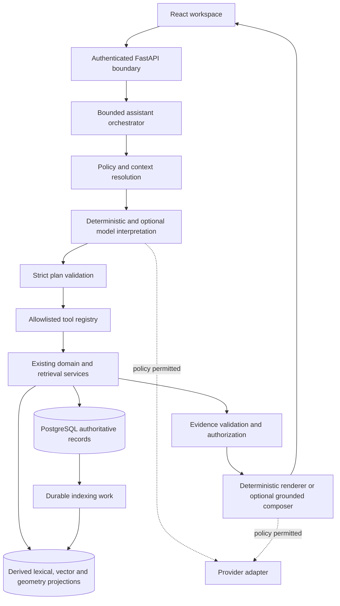

# Modelryx AI design specification

Status: Proposed implementation specification, version 1.0  
Date: 2026-11-20  
Source reviewed: [`tmp/modeltyx-ai-architecture.md`](../../tmp/modeltyx-ai-architecture.md); an identical copy exists in `tmp1`.  
Scope: Engineering search, grounded answers, bounded orchestration, and controlled action integration.

This specification uses the repository product name, **Modelryx**. Requirements below describe the target design unless explicitly identified as existing repository foundations. They are not claims that the implementation or production deployment passes them today.

## 1. Architecture review

The proposed architecture has sound core decisions: keep PostgreSQL authoritative, treat vectors as derived data, separate interpretation from execution, and use typed tools. Adopt those decisions with the following corrections before implementation.

| Priority | Finding | Required design decision |
| --- | --- | --- |
| P1 | The conceptual flow sends the user directly to the LLM before authentication. | All requests enter the authenticated backend first. Provider policy and readable context are resolved before any provider call. |
| P1 | Revision identity alone does not identify mutable working content. | Bind evidence, comparisons, projections, and action preconditions to a revision plus an immutable content version or source hash. |
| P1 | Permission filtering after candidate retrieval can leak information or starve authorized results. | Scope every retrieval branch before ranking, then reauthorize evidence before delivery. Counts, suggestions, caches, and relationship paths obey the same policy. |
| P1 | Confirmation is described without a binding or concurrency contract. | Confirm a server-stored proposal digest, actor, exact targets, state versions, and expiry; recheck authorization and state during execution. |
| P1 | Index refresh is recommended but reliable publication and recovery are unspecified. | Use durable post-commit work, idempotent generation builds, atomic activation, and reconciliation. Index failures cannot roll back CAD publication. |
| P2 | The roadmap assumes capabilities are new even where repository foundations exist. | Extend existing assistant, search, knowledge, and actions services; avoid a competing assistant or retrieval stack. |
| P2 | Provider interchangeability omits embedding-space compatibility. | Version embedding model, dimensions, normalization, and chunking together; never compare vectors from incompatible spaces. |
| P2 | Hybrid scoring, limits, missing data, and partial results are unspecified. | Adopt explicit contracts and release gates below. |

### Existing foundations and gaps

Evidence comes from the repository documents and selected source files, not a runtime audit.

| Area | Repository evidence | Design implication |
| --- | --- | --- |
| Assistant | `assistant/models.py`, `assistant/service.py`, `api/assistant.py`; identifier-only context, typed references/actions, read-only intents | Preserve the current request and response contracts; add versioned extensions for evidence and multi-tool plans. |
| Engineering search | `engineering_search/` and [search reliability specification](engineering-search.md) | Reuse its capability registry, validated request, interpreter, executor, ranking, and evaluation corpus. |
| Knowledge retrieval | `knowledge/`, `models/knowledge.py`, `api/knowledge.py` | Use the knowledge layer for richer evidence; keep legacy revision RAG compatible while migration is planned. |
| Provider | `services/ai.py` implements an OpenAI-compatible gateway | Wrap this integration behind a provider contract. Other native provider adapters remain proposed. |
| Controlled actions | `actions/`, `api/actions.py`, `models/actions.py`; assistant documentation defers direct action execution | Reuse the action engine after verifying its guarantees; do not enable assistant execution merely because an action API exists. |
| Indexing | [Overview](overview.md) describes independent refresh after CAD commit and explicit reindexing | Add durable recovery and generation freshness contracts; do not assume current refresh is transactional delivery. |
| Geometry | Architecture proposes CAD descriptors; assistant already offers similarity workflows | Verify descriptor coverage and scoring independently. Existing similarity must not be relabeled geometric equivalence. |

## 2. Goals and boundaries

The system must answer questions about readable engineering records with explicit revision scope and verifiable sources. Structured search, BOM traversal, comparison, and validation remain useful without a model provider. Model assistance may interpret supported language and summarize evidence; it cannot establish engineering truth.

Initial delivery is read-only. Writes, native CAD changes, release decisions, and approval transitions are disabled in the assistant until their dedicated action gates pass. Training a general model, arbitrary SQL, generated code execution, and inferred part interchangeability are outside scope.

## 3. Components and request flow



The orchestrator runs in the existing backend initially. Domain services own authorization and engineering rules. The provider receives only the minimum policy-approved context; it has no database credentials, worker credentials, or direct execution channel.

Request sequence:

1. Authenticate, check workspace access and conversation ownership, validate input size, and assign a trace ID.
2. Resolve supplied identifiers against current readable records. Browser context and previous messages never grant access.
3. Select an enabled capability and resolve revision policy. Ask for clarification when identity or critical constraints are ambiguous.
4. Interpret the request using the existing deterministic/provider-assisted search pipeline. Validate all model output against strict schemas with unknown fields rejected.
5. Validate a bounded plan. Execute each tool under the current principal using existing services, rather than internal HTTP requests.
6. Collect evidence, refresh visibility checks, detect stale or missing sources, and produce a typed result.
7. Render verified values and citations. Optional prose generation receives evidence only and cannot replace structured results.
8. Store a bounded, protected execution record and return the response with warnings and trace ID.

## 4. Context, identity, and revision semantics

- Canonical IDs are UUIDs; display names are resolver inputs only. Ambiguity returns readable candidates without exposing hidden matches.
- Context contains identifiers and supported selections, not client-supplied engineering facts or provider instructions.
- Explicit revision selection wins. A revision workspace pins its current revision. Cross-item search uses a disclosed policy such as `latest_readable`, `latest_released`, or `all_readable`.
- `latest_released` means the latest revision satisfying both release and visibility rules; a newer hidden revision must not be disclosed.
- Working content must include a content-version identity or verified source hash. Until snapshot-aware context is implemented, retain the existing restriction on historical-content assistant queries.
- Follow-ups modify a previous validated request only after context and permissions are rechecked. A changed workspace invalidates incompatible inherited identifiers.
- BOM tools traverse the authoritative version-resolved graph, preserve occurrence paths and quantities, detect cycles, and disclose truncation. Direct where-used and recursive where-used are separate modes; neither silently substitutes for the other.
- Missing, unsupported, failed extraction, and confirmed absence are distinct states. A part matches “no holes” only when supported extraction successfully confirms zero holes.

## 5. Tool and orchestration contracts

Logical tool names below are registry entries, not proposed public HTTP endpoints. Existing names may be retained through adapters.

| Tool | Required validated inputs | Output and constraints |
| --- | --- | --- |
| `search_items` | Existing typed search request and explicit revision policy | Authorized revisions, applied filters, stable cursor, warnings |
| `get_item_revision` | Item and revision IDs | Readable metadata and content identity |
| `get_bom` | Assembly revision, traversal mode, depth | Occurrence paths, quantities, coverage and truncation |
| `get_where_used` | Component revision, direct/recursive mode | Readable parent paths and lifecycle evidence |
| `compare_revisions` | Two readable content identities | Deterministic differences; no invented change reason |
| `search_documents` | Query, entity scope, result limit | Authorized passages and source locations |
| `search_similar_geometry` | Readable reference content, descriptor version, filters | Ranked candidates, descriptor coverage and differences |
| `get_validation_results` | Readable revision and optional owned job ID | Stored findings and processing state |

Each registry entry declares schema version, permission requirements, read/write classification, timeout, result cap, and deterministic handler. Tenant/workspace scope and actor are injected by the server, never accepted from model arguments.

Proposed initial configurable ceilings: six tool calls and three sequential rounds per message; 30-second orchestration deadline; 100 search records per page; 20 evidence passages; BOM depth 10 and 1,000 visited occurrences. Lower existing endpoint limits remain effective. Exceeding a cap returns an explicit partial result or narrowing request, never a claim of exhaustive coverage. Provider calls share the deadline and token budget. Budget exhaustion stops the plan.

Read retries are limited to one transient-failure retry within the deadline. Validation failures are not retried blindly. Mutations use the action engine's idempotency and recovery protocol rather than automatic tool replay.

### Proposed response extension

Preserve the current assistant fields (`conversation_id`, `message_id`, `answer`, `intent`, `references`, `actions`, `warnings`, `trace_id`). Introduce a negotiated/versioned response extension before adding new required fields or enum values to existing clients:

```json
{
  "schema_version": "2",
  "status": "complete",
  "interpretation_mode": "hybrid",
  "resolved_scope": {
    "revision_policy": "explicit",
    "revision_ids": ["11111111-1111-4111-8111-111111111111"]
  },
  "evidence": [{
    "evidence_id": "e1",
    "source_type": "revision_metadata",
    "item_id": "22222222-2222-4222-8222-222222222222",
    "revision_id": "11111111-1111-4111-8111-111111111111",
    "content_version_id": "33333333-3333-4333-8333-333333333333",
    "source_hash": "sha256:<verified digest>",
    "locator": {"field": "mass_kg"},
    "value": 2.7,
    "unit": "kg"
  }],
  "claims": [{"text": "The recorded mass is 2.7 kg.", "evidence_ids": ["e1"]}],
  "coverage": {"truncated": false, "index_state": "current"}
}
```

Values are illustrative. Status values are `complete`, `partial`, `needs_clarification`, `unsupported`, and `unavailable`. Client, authentication, and authorization errors retain appropriate HTTP errors. “No matches” is a successful empty result, distinct from a tool failure. Hidden and nonexistent target IDs receive the same external response according to the existing visibility policy.

## 6. Retrieval and ranking

Structured predicates are hard eligibility constraints. Normalize units before comparison and retain original displayed units. Unsupported predicates require clarification or an explicit unsupported response; dropping a constraint and presenting a broader search as equivalent is prohibited.

Each lexical, vector, geometry, and relationship branch operates within an authorized eligible set. Reauthorize final sources immediately before serialization and before sending evidence to a provider. If approximate vector filtering cannot supply enough authorized candidates, use bounded additional retrieval or exact search for the eligible set, or return partial coverage. Do not pad results with unauthorized or filter-violating records.

For a new hybrid path, use reciprocal-rank fusion as the initial baseline: `score(d) = sum(1 / (60 + rank_branch(d)))` across enabled branches, followed by stable canonical-ID tie-breaking. Preserve the existing engineering-search ranker until corpus comparisons justify migration. Record branch participation and ranker version; do not compare raw lexical, cosine, and geometry scores as equivalent quantities. Optional reranking receives only authorized candidates and cannot change eligibility.

Pagination cursors bind the normalized request, scope, ranker/index generation, and ordering boundary. A generation change that prevents stable continuation returns an explicit restart requirement. Counts and completeness claims must state whether they are exact or bounded.

Geometry descriptors record units, coordinate/scale normalization, extraction algorithm, CAD provenance, and quality. Basic descriptors provide coarse similarity only. Distinguish shape similarity, duplicate evidence, and functional interchangeability; the latter is never inferred from a similarity score.

## 7. Evidence and answer generation

Every engineering factual claim must reference server-issued evidence. Revision metadata citations include content identity and field path; document citations include artifact version/hash and page or section plus chunk location; BOM citations include the source assembly content and occurrence path.

The composer receives evidence IDs, excerpts, and allowed presentation instructions. It cannot introduce citations, IDs, values, or navigation targets outside the evidence bundle. Deterministically verify citation membership and structured numeric values. Citation membership alone cannot prove prose entailment; evaluate that separately and use deterministic templates for exact-filter results and critical lifecycle/validation statements.

Missing or contradictory evidence produces an explicit limitation. An invalid generated answer falls back to a deterministic evidence summary. Render text safely and create links/actions only from server-owned typed references. Retrieved instructions cannot authorize tools or change system policy.

## 8. Projection schema and indexing lifecycle

Extend existing projection entities where practical; the following is a logical contract, not a migration against verified table definitions:

| Record | Required attributes |
| --- | --- |
| Source/chunk | Security scope, entity/revision/content identity, artifact identity, source hash, chunk key, location, text, extraction/chunking versions |
| Embedding generation | Source/chunk identity, provider/model identity, dimensions, embedding-space version, vector, generation ID, active state |
| Geometry projection | Source content/hash, descriptor version, normalized features, units, extraction quality and supported coverage |
| Index job | Idempotency key, source identity/hash, target generation, state, attempts, next retry, bounded error code and timestamps |

Use the deployment's actual security scope; adding `tenant_id` to projections alone does not establish multi-tenancy. A shared-tenant deployment requires authoritative tenant ownership and enforced tenant predicates across domain and projection queries before it is supported.

Index lifecycle:

1. Commit authoritative content and durable indexing intent in the same database transaction, using an outbox or equivalent transactional job record.
2. An index worker claims work with a lease. Deduplicate by source identity/hash, projection version, and embedding-space version.
3. Build a new generation in staging. Validate hashes, dimensions, finite vector values, extraction coverage, and source existence.
4. Activate only if the source still matches the requested version. Atomically switch the active generation; stale jobs cannot replace newer content.
5. Retry transient failures with bounded exponential backoff; quarantine permanent failures and expose reindex controls.
6. Reconcile missing/outdated projections periodically. Handle deletion and retention with tombstones and purge jobs; recheck current ACLs even before a purge completes.

Freshness is computed from content/hash and projection versions, not timestamps alone. Stale passages may be returned only as explicitly historical evidence when requested and still readable. Current-state answers must not silently use stale projections.

The current documented vector schema uses 1536 dimensions. A new embedding model requires a compatible versioned space, backfill, validation, and atomic activation; changing a configuration string is insufficient. Preserve lexical retrieval during rebuilding and provide rollback to a retained compatible generation.

## 9. Provider contract and data policy

Expose `interpret(schema, context, deadline)`, `compose(evidence, deadline)`, and `embed(texts, space_version, deadline)` behind an adapter with capability discovery. Normalize timeout, rate limit, unavailable, invalid-output, and policy-denied outcomes. Model identity, schema version, and prompt version are recorded in protected traces.

Before every external call, enforce deployment/workspace policy for permitted provider, model, data classification, and outbound fields. Embedding queries and indexed source text are engineering-data disclosures too. If policy is absent, external processing remains disabled. Keys stay server-side; provider error bodies must be sanitized before client responses or ordinary logs.

Without chat, retain deterministic supported intents and rendering. Without embeddings, retain structured and lexical search and disclose reduced semantic coverage. Do not claim equivalent natural-language understanding for unsupported requests. Indexing and provider failure cannot invalidate committed engineering data.

## 10. Controlled action integration

Assistant action execution is a separate release increment, disabled by default. The model may request a proposal through an allowlisted operation; only the existing domain action handler may mutate data.

Proposed lifecycle: `DRAFT -> READY -> CONFIRMED -> EXECUTING -> SUCCEEDED | FAILED`, with `EXPIRED`, `CANCELLED`, and `STALE` terminal alternatives before execution. Confirmation binds a server-generated digest of the operation, targets, normalized arguments, expected state/content versions, actor, scope, and expiry. The UI presents the exact diff and consequences before a dedicated confirmation request.

On execution, reauthorize, validate confirmation ownership and expiry, compare authoritative state versions, and apply the domain mutation plus audit and idempotency record in one transaction where possible. Reject stale state and require a new proposal. A uniqueness constraint binds idempotency keys to actor, scope, and operation digest; reuse with different arguments is rejected.

For external CAD jobs, commit a durable job intent, dispatch with an idempotent job identity, and reconcile uncertain outcomes. Do not claim exactly-once execution across the database/worker boundary. A confirmed submission authorizes only the reviewed operation; it does not authorize later release or approval transitions.

## 11. Security, storage, and operations

- Enforce visibility for facts, snippets, similarity references, counts, suggestions, errors, audit views, and replayed conversation messages. Ownership of a conversation does not preserve access to revoked engineering content; redact inaccessible historical sources and dependent stored answer text on read.
- Cache keys include security scope/principal visibility version, normalized request, source versions, provider policy, and ranker/generation. Disable shared answer caching until permission invalidation is proven.
- Conversation/tool evidence storage follows engineering-data access and retention controls. Ordinary metrics contain aggregate counts, durations, error codes, and trace IDs; raw prompts and retrieved content are excluded by default.
- Bound document extraction by file size, page count, parse time, and supported type; process untrusted documents in an isolated worker. Never fetch arbitrary model-generated URLs or storage paths.
- Apply request and cost limits per principal and security scope. Cancellation prevents additional tool/provider work and releases worker leases safely.
- Track tool failures, fallback rate, index lag, dead-letter jobs, citation failures, provider latency, and budget exhaustion. Avoid user IDs and raw query text as metric labels.

## 12. Verification and release gates

Reuse the locked engineering-search corpus and its stricter existing gates. The targets below are proposed acceptance requirements, not measured results.

| Gate | Required evidence |
| --- | --- |
| Exact retrieval | Validated request returns the same authorized record membership as equivalent direct backend execution. |
| Interpretation | Existing search gates: critical-filter exact match >=98%, all-field match >=95%, no invented unsupported constraints in the locked set. |
| Authorization | Zero leaks in tests for cross-user/scope records, counts, snippets, BOM paths, caches, revoked conversation sources, and provider payloads. |
| Evidence | Every returned citation resolves to the exact readable source version; zero fabricated IDs or unsupported numeric values in the locked set. |
| Grounding | Domain-reviewed factual-claim support >=98% on a locked answer corpus; all critical lifecycle, validation, and exact-filter statements use verified templates or structured values. |
| Index reliability | Duplicate, out-of-order, crashed, deleted-source, and stale jobs cannot activate incorrect generations; reconciliation recovers missed work. |
| Action safety | Tampered, expired, replayed, cross-actor, unauthorized, and stale confirmations are rejected; concurrent retries create one domain mutation/job intent. |
| Degraded operation | Disabled, timed-out, malformed, or policy-blocked providers preserve deterministic supported behavior and explicit warnings. |
| Performance | Existing targets: p95 search execution <500 ms and assisted search <5 s against a dated, agreed dataset/hardware profile; orchestration obeys its deadline. |
| UX | Applied filters, revision scope, citations, partial coverage, missing data, and correction controls are visible; existing user-study gates remain required. |

Test recursive BOMs and cycles, mass/unit boundaries, feature-present/absent/unknown states, ambiguous names, multilingual or unsupported text, prompt injection in source documents, ACL changes during a request, and model/dimension migration. Use seeded PostgreSQL/pgvector integration tests for retrieval rather than relying solely on mocked tools.

Record commit, corpus version, configuration, model/space versions, dataset, hardware, and dated results. Existing documentation lists external performance, usability, and sign-off evidence as pending; this specification does not close those gates.

## 13. Delivery plan

| Increment | Work | Exit condition |
| --- | --- | --- |
| A: Baseline | Inventory current routes, schemas, permissions, tools, and action guarantees; run existing corpus | Dated capability/gap matrix and baseline report |
| B: Read-only contract | Scope resolution, evidence identities, bounded orchestration, versioned response extension | Exact-query parity, authorization, and no-provider gates pass |
| C: Reliable projections | Durable jobs, generation activation, freshness, recovery, embedding migration | Crash/replay/staleness and migration tests pass |
| D: Hybrid evidence | Authorized fusion, document ingestion, geometry coverage and citations | Locked retrieval and grounding gates pass |
| E: Multi-tool assistant | Dependent plans, partial results, cost limits, correction UI | Adversarial, deadline, and user-task gates pass |
| F: Confirmed actions | Action-engine integration, reviewed proposals, concurrency and worker recovery | Action-safety gates and explicit product enablement |

Each increment ships behind capability flags and can be disabled independently. Rollback disables the new capability, preserves authoritative data, and selects the previous compatible projection generation where available.

## 14. Decisions to finalize during baseline

Confirm the actual tenant/workspace isolation model, authoritative working-content version token, initial writable operation allowlist, geometry descriptor coverage, document formats/OCR requirements, provider data policy, retention periods, and production reference dataset/hardware. These decisions gate their dependent increments; they do not block the read-only contract work.
